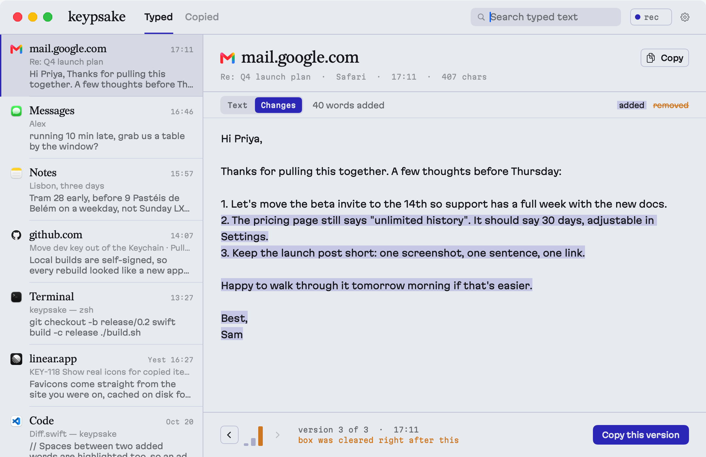
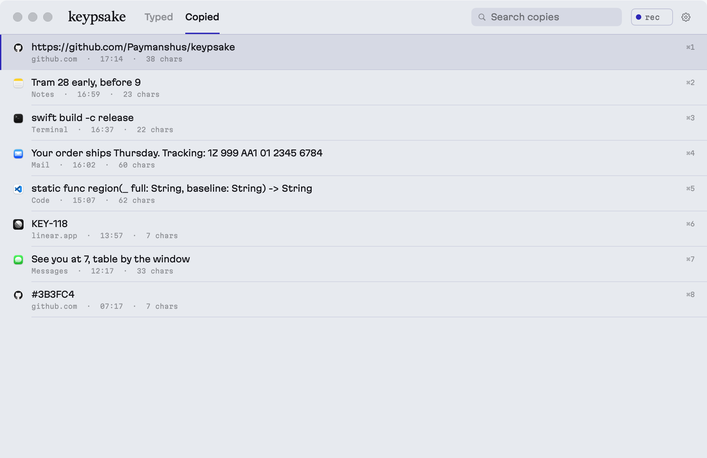
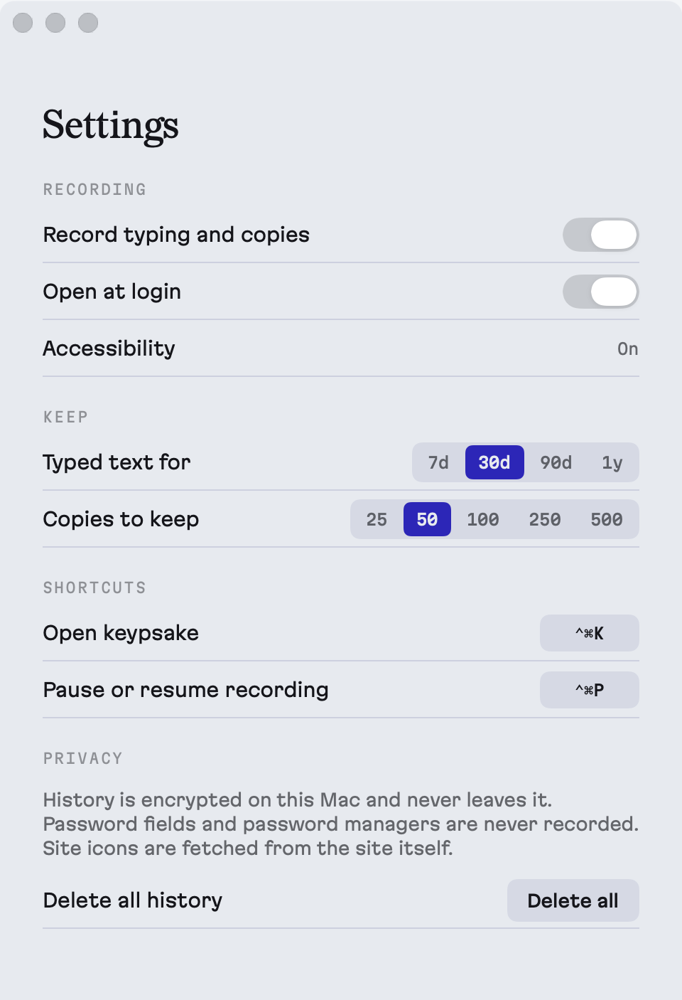

<p align="center">
  
</p>

# keypsake

Everything you type, kept. A small macOS app that quietly saves what you type into any text box, in any app, so a crashed tab, a stray click or a cleared form never costs you a long piece of writing again. It also keeps a short clipboard history.

<picture>
  <source media="(prefers-color-scheme: dark)" srcset="docs/typed-dark.png">
  
</picture>

## What it does

- **Typed.** One entry per text box you typed into, with the app or website, its real icon and the window title. Only what you typed this time is kept: text that was already in a note or document stays out.
- **Versions, and the moment text was lost.** As you write, keypsake keeps versions. If a box suddenly empties or loses most of its text, the version just before is saved and marked in amber ("box was cleared right after this"), and it is the one shown first.
- **Changes anyone can read.** Switch a version to *Changes* to see it against the one before: added words highlighted, removed words struck through, plus a plain summary like "40 words added".
- **Copied.** Your last 25 to 500 copies (you choose), with the source app or site. Click or press ⌘1–9 to copy one back.
- **Menu bar and Dock.** Lives in both. ⌃⌥K opens it, ⌃⌥P pauses recording.

<picture>
  <source media="(prefers-color-scheme: dark)" srcset="docs/copied-dark.png">
  
</picture>

## Privacy

- History is encrypted (AES-GCM) and stored only on your Mac. Nothing is sent anywhere.
- Password fields, password managers and items marked as concealed on the clipboard are never recorded.
- Terminals record your keystrokes (the commands you typed), not their whole scrollback.
- Site icons are fetched from the site you were on and cached. No third-party icon service.
- Typed text is deleted after 7, 30, 90 or 365 days (your choice). Pause anytime, or delete everything in Settings.

<p align="center"></p>

## Install from source

Needs macOS 14+ and the Xcode Command Line Tools (`xcode-select --install`). Full Xcode is not required.

```bash
git clone https://github.com/Paymanshus/keypsake.git
cd keypsake
./scripts/setup-signing.sh   # once: a local signing identity so macOS remembers permissions across rebuilds
./build.sh                   # builds, installs to /Applications and opens it
```

Then turn on **Accessibility** for keypsake when asked (System Settings → Privacy & Security → Accessibility). That is the only permission it needs. Clipboard history works without it.

If keypsake is switched on in that list but still asks, the entry belongs to an older build: click **Already on? Fix it** in the app, then switch it on again.

## How it works

- `Capture.swift`: a global key monitor triggers reads of the focused text box through the Accessibility API. If an app does not expose its text (Google Docs, some Electron apps, terminals), the text is rebuilt from keystrokes. A "cliff" (sudden large drop in length) saves the version before it.
- `Store.swift`: SQLite with every text field sealed by CryptoKit. Developer ID builds keep the key in the Keychain; local self-signed builds keep it in a file only your user can read, because each local build would otherwise trigger a Keychain prompt.
- `Diff.swift`: word-level diff on Swift's `CollectionDifference`.
- `Views.swift`, `Settings.swift`: SwiftUI hosted in AppKit windows.

Design: Redaction (display), Martian Grotesk (UI) and Martian Mono (meta), all SIL OFL and bundled in `Resources/Fonts`. Palette: fog `#ECEEF2`, ink `#1B1C22`, carbon `#3B3FC4`, amber `#D98A2B` reserved for "text was lost here".

Screenshots come from `keypsake --demo --snap docs` (made-up data, nothing recorded). The motion graphic is rendered by `Resources/Video/render_video.swift`: [keypsake.mp4](docs/keypsake.mp4).

## Distributing

To ship builds other people can open without warnings, sign with an Apple Developer ID and notarize. Users then only grant Accessibility, once, and it carries across updates.
